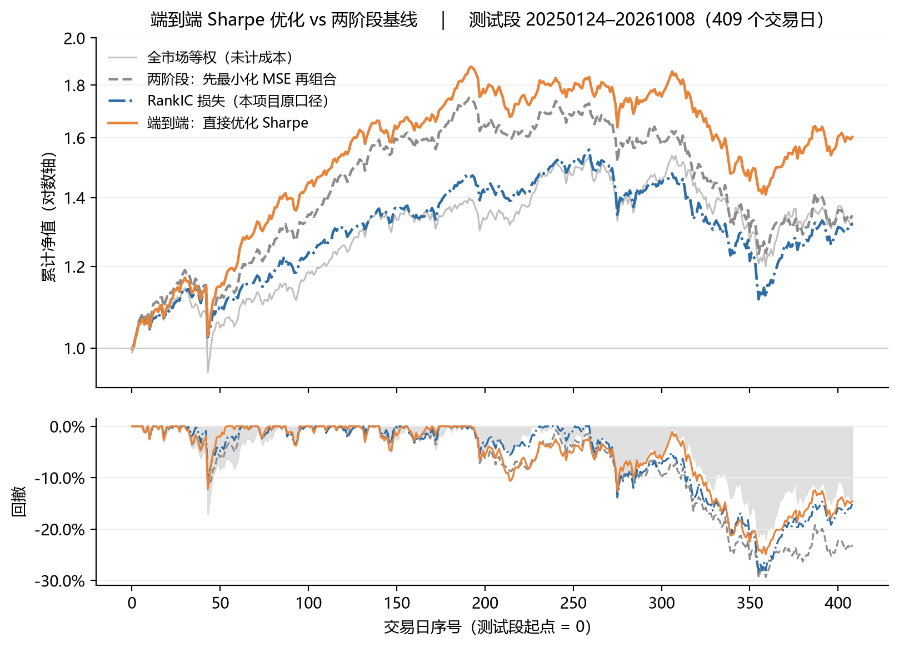

# A 股单因子挖掘 —— 仿东吴《深度学习系列1》的 LLM 驱动因子改进与生成

> 在 A 股全市场日线面板（2020–2026，1638 个交易日 × 5800 只）上，复现并扩展东吴证券
> 《深度学习系列1：AI 重塑量化》第 1 章的**单因子挖掘**方法论：
> 以 **RankIC / ICIR** 为唯一评价标准，走「**因子优化**」与「**案例驱动生成**」两条路线，
> 并对产出做**低相关性（新颖度）验证**。

---

## TL;DR

| 指标 | 结果 |
|---|---|
| 评测因子总数 | **156**（全部逐条落盘，含失败状态，无静默丢弃） |
| 达标因子数（\|ICIR\| ≥ 0.35，日频） | **32 个** |
| 最优新构造 | **`ts_mean(upper_shadow, 5) × turnover_rate`**，IC **−0.0685**，三段几乎完全一致 |
| \|ICIR\| 最高（全截面） | **`turnover / ts_mean(turnover, 60)`** = **−0.438**（换手加速度） |
| 路线1 最有效改进 | `volatility → True Range`，IC **−0.0340 → −0.0499（+46.9%）** |
| **最关键结论** | **IC 高是真的，信息新是假的** —— 与既有 140 列特征池的 `max\|ρ\|` 中位 **0.939**，**无一低于样例集自身的内部冗余度 0.376** |
| **端到端优化（`e2e/`）** | 直接对 **Sharpe** 反传：Sharpe **1.65**、IC 0.0596；直接对 **年化收益** 反传：年化 **54.1%**、Sharpe **2.32**。两者 IC 都低于两阶段（0.0791） ⇒ **「预测准 ≠ 组合好」** |

**一句话**：超额收益的瓶颈不是「表达力」也不是「搜索强度」，而是**信息维度**。
详见 [`docs/单因子挖掘_研报1仿效.md`](docs/单因子挖掘_研报1仿效.md)。

---

## 1 方法（与研报的对齐关系）

| 环节 | 东吴《系列1》 | 本仓库 |
|---|---|---|
| 因子体系 | Qlib **Alpha158**（42 基础因子 × 5 窗口） | **Alpha158 等价因子集**（41 个，见 `sf/factors.py::BASE158`） |
| 可用变量 | `$open $close $high $low $vwap $volume` | 复权 OHLC **＋ 换手率 / 量比 / 流通市值 / 估值 / 涨跌停幅度 / 涨停明细（封单·连板·封板时间·开板次数）** |
| 算子 | Qlib ops | **同名同义 42 算子**（`sf/ops.py`）：`ref / delta / ts_mean / ts_std / ts_sum / ts_max / ts_min / ts_median / ts_mad / ts_rank / ts_z / ts_quant / ts_argmax / ts_argmin / ts_skew / ts_kurt / ts_count / ts_slope / ts_resi / ts_rsqr / ts_corr / ema` ＋ 截面 `cs_rank / cs_z / cs_demean` ＋ 逐元素 `neg / abs / sign / log / sqrt / sqr / relu / inv / power / gt / lt / add / sub / mul / div / max2 / min2` |
| 路线1 · 优化 | prompt 给「表达式＋IC」，多轮迭代，目标 RankIC ≥ 1.5× | LLM 提议器（人工在环）对最强基础因子提改进方案并迭代 **2 轮** |
| 路线2 · 生成 | ① 从零生成（**失败**：20 轮 ICIR 只到 0.59）<br>② **案例驱动**（给「原始＋优化＋IC」当成功案例，要求低相关）⇒ ICIR 0.83~0.87 | 直接走**路线②**，生成 54 个候选（2 轮迭代） |
| 去量纲纪律 | prompt 硬要求「转换成比例形式，使不同股票间可比」 | **强制执行**：原始价格为未复权 ⇒ 统一复权后**只允许比值/收益率形态**入表达式（裸价格量在逐日截面 IC 上天然 ≈ 0） |
| 评价 | 周频、VWAP 成交、市值行业中性化 ⇒ RankIC 均值 ＋ ICIR，目标 ICIR > 0.8 | **日频**：次日复权收益的逐日截面 Spearman ⇒ IC / ICIR / t / 胜率；两个口径（剔 ST+跌停 / 再剔涨停）；**三段（按样本比例切分：60% / 15% / 25%）** + 逐年稳定性 |
| 达标线 | ICIR > 0.8（周频） | **\|ICIR\| ≥ 0.35**（周频 ↔ 日频换算 ×√5） |

**为什么日频门槛是 0.35**：ICIR 随频率近似按 `√频率` 缩放；周频 0.8 ≈ 日频 0.8 ÷ √5 ≈ 0.36。
本仓库统一用 **0.35** 作为「达到研报同等统计强度」的判定线。

---

## 2 数据

| 项 | 说明 |
|---|---|
| 范围 | **2020-01-02 ~ 2026-10-09**，**1638 个交易日** × **5800 只**（日均 5158 只有效） |
| 频率 | 日频 |
| 字段 | OHLCV、成交额、昨收、涨跌幅、**换手率（自由流通）**、**量比**、流通市值、PE/PB/PS/股息率、**涨停/跌停/炸板/ST 标志**、**涨停价幅度（区分主板 10% / 双创 20% / 北交所 30%）**、**封单额、封板/开板时间、连板数、开板次数** |
| 标签 | `y1` = 次日复权收益率（有效率 95.3%） |
| 复权 | 用分红送转数据自建后复权；与行情源 `pct_chg` 交叉校验一致率 **99.90%** |

> ⚠️ **原始行情数据不随本仓库分发**（体积与数据源条款限制）。
> 仓库只包含**代码、因子表达式、评测结果与文档**。重建面板见 [`data/README.md`](data/README.md)。

---

## 3 仓库结构

```
.
├── README.md
├── requirements.txt
├── .gitignore
├── sf/                          # 单因子挖掘核心
│   ├── ops.py                   #   42 算子 + 41 终端 + 单因子评估器 + 因果审计
│   ├── factors.py               #   因子定义集（BASE158 / NEWDATA / OPT / NEW）
│   ├── run.py                   #   评估驱动器（--stage base|new|opt|gen|all）
│   ├── rho.py / rho2.py         #   低相关性诊断 + 新颖度参照系
│   ├── summary.py               #   汇总表生成
│   ├── opt_candidates.json      #   路线1 候选（32 条，含 2 轮 + 秩免疫对照）
│   └── new_candidates.json      #   路线2 候选（54 条，含 2 轮）
├── e2e/                         # 端到端组合优化：直接对 Sharpe 反传
│   ├── data.py                  #   面板读取 + 无未来函数的可交易掩码（剔次新/停牌/涨停）
│   ├── model.py                 #   可微组合层（top-k + softmax）+ 三种损失
│   ├── train.py                 #   训练（--arm mse|ic|sharpe）
│   ├── backtest.py              #   多种子汇总 + 净值曲线 + 指标表
│   ├── run_all.sh               #   三臂 × 三种子
│   └── README.md                #   方法、结果与局限
├── results/                     # 全部 156 个因子的逐项指标 + 相关性诊断
│   ├── ic_table_{base,new,opt,gen}.csv / .json
│   ├── rho_table.json
│   └── rho2_table.json
├── docs/
│   └── 单因子挖掘_研报1仿效.md    # 完整技术报告
└── data/
    ├── README.md                # 数据字典与重建说明
    └── make_panel.py            # 面板重建模板（凭据走环境变量）
```

---

## 4 快速开始

```bash
pip install -r requirements.txt

# 评估全部因子（需要先在 data/ 下放好面板，见 data/README.md）
python sf/run.py --stage all

# 汇总表 & 低相关性诊断
python sf/summary.py
python sf/rho2.py
```

算子库自检（不需要数据，验证秩免疫与因果性）：

```bash
python sf/ops.py     # 会打印秩免疫对照与因果审计结果
```

端到端组合优化（需要 `torch`，CPU 约 7 分钟）：

```bash
bash e2e/run_all.sh        # 三臂 × 三种子
python e2e/backtest.py     # 汇总 → 净值曲线 png + e2e_metrics.csv
```

---

## 5 主要结果

### 5.1 路线 0：Alpha158 等价因子集（41 个）

|IC| 中位 **0.0293**，**12 个达标**，**37/41 三段同号**。

| 族 | 因子 | 表达式 | IC | ICIR |
|---|---|---|---|---|
| K线 | KLEN | `(H-L)/O` | **−0.0648** | −0.408 |
| K线 | LOW0 | `L/A` | **+0.0644** | **+0.509** |
| K线 | KLOW1 | `(min2(O,A)-L)/O` | −0.0519 | −0.496 |
| 量 | VMIN | `ts_min(turn,20)/turn` | +0.0493 | +0.498 |
| 量价 | CORD | `ts_corr(A/ref(A,1), log(turn/ref(turn,1)), 20)` | −0.0377 | −0.389 |

**读法**：主力是 **K 线形态（振幅 / 下影 / 收盘位置）＋ 换手率的分布形状**；
`STD / BETA / RSQR / RESI` 这类趋势统计量普遍偏弱。

### 5.2 路线 1：因子优化

| 基准 | 基准 IC/ICIR | 改进 | 改进 IC/ICIR | Δ | 逻辑 |
|---|---|---|---|---|---|
| **STD** `ts_std(A,20)/A` | −0.0340/−0.188 | **STD_opt1** `ts_std(max2(H−L, max2(\|H−ref(A,1)\|, \|L−ref(A,1)\|)), 20)/A` | **−0.0499/−0.292** | **+46.9%** | **简单振幅 → 真实波幅 TR（含跳空）** |
| **MA** `ts_mean(A,20)/A` | +0.0400/+0.239 | **MA_opt2** `ts_mean(L,20)/A` | **+0.0455/+0.276** | **+13.7%** | 均线改用**最低价**（下沿支撑位偏离） |
| VQTLD | +0.0474/+0.472 | 分位 20% → 10% | +0.0490/+0.490 | +3.4% | 更极端的低换手 |

**第 2 轮 8 个候选无一超过第 1 轮最优** —— 与研报「避免过度优化、收益递减」的观察一致。

### 5.3 路线 2：案例驱动生成（Top）

| 族 | 因子 | 表达式 | IC | ICIR |
|---|---|---|---|---|
| 影线 | **USH5_TURN** | `ts_mean(ush,5) × turn` | **−0.0685** | −0.395 |
| 影线 | **USH_TURN** | `ts_mean(ush,20) × turn` | **−0.0677** | −0.365 |
| 影线 | USH_FRAC_TURN | `ts_mean(ush,20)/ts_mean(hl,20) × turn` | −0.0657 | −0.401 |
| 趋势 | **TURN_ACCEL** | `turn / ts_mean(turn,60)` | −0.0495 | **−0.438** |
| 量价 | VW_RET | `ema(r1×turn,20) / ema(turn,20)` | −0.0499 | −0.354 |
| 半方差 | SEMIVAR_RATIO | `(ema(↑·r²) − ema(↓·r²)) / ts_std(r1,20)` | −0.0526 | −0.279 |

**`USH_TURN` 家族的核心发现**：`上影线 × 换手率` —— 换手率衡量「谁在卖」，上影线衡量「卖得多狠」，
相乘 = **抛压强度**。它在 **三段（早期 / 中期 / 近期）的 IC 分别为 -0.0677 / -0.0696 / -0.0697**，
是全部 156 个因子里跨段最稳的之一。

**半方差族**（研报最成功的结构）在本面板上同样有效：三个变体 IC 一致在 −0.052 左右。

### 5.4 ⭐ 低相关性验证：**不过关**

研报要求「生成的新因子与样例相关性尽可能低」。我们做了量化，并引入**参照系**：

| 参照系 | Alpha158 等价样例集**内部**两两 `max\|ρ\|`：n=820 对，**中位 0.376** |
|---|---|

| 检验 | 结果 |
|---|---|
| 与既有 **140 列特征池** `max\|ρ\|` | **中位 0.939**；<0.5 的 **0/32** |
| 与 **Alpha158 等价样例集** `max\|ρ\|` | 0.72 ~ 1.00；**低于参照系 0.376 的 0/25** |

**原因**：既有特征池里本来就有 `turnover_f`、`rng`、`lower_sh`、`atr14`、`vma20`、`mdev20`、`pos_close`，
所以 `KLEN ↔ rng`、`KLOW1 ↔ lower_sh`、`turn ↔ turnover_f` 的相关系数都是 **1.000**。

> ⇒ **「IC 高」是真的，「信息新」是假的** —— 挖到的强因子绝大多数是既有池的重新发现。
> 这与「给定特征池内的删/留/换，期望净收益 ≈ 0」的守恒律一致。

### 5.5 一个必须单列的现象：低覆盖事件因子

| 因子 | 表达式 | IC | ICIR | **覆盖率** |
|---|---|---|---|---|
| SEAL_TURN | `zt × seal × turn` | **−0.1650** | −0.889 | **0.013** |

封单强度 × 换手在**涨停股**上 IC 极高，但**只有 1.3% 的股票-日有值** ⇒ 它是**事件因子，不是全截面因子**。
事件类字段的信息密度极高、但只存在于事件区，必须配合「事件区域内部排序」才有用。

---

## 6 端到端组合优化：把 Sharpe / 年化收益直接当损失反传

> 两阶段「先最小化 MSE 预测收益 → 再丢进优化器出权重」的错配在于：**MSE 不是决策目标**。
> `e2e/` 把「打分 → 权重 → 组合日收益（含成本）→ 组合指标」整条链路做成可微，
> 直接对 **Sharpe** 或 **年化几何收益** 反传（年化收益用 `−mean(log(1+r))·252`，同样可导）。

三种目标**只换损失**（网络 / 组合层 / 种子 / 切分 / 成本全部相同）：

| 臂 | 损失 | 年化 | 波动 | Sharpe | MDD | RankIC |
|---|---|---|---|---|---|---|
| 两阶段 MSE | `MSE(score, y1)` | 20.1% | 20.4% | 0.98 | −29.5% | **0.0791** |
| RankIC | `−Pearson(score, rank(y1))` | 18.8% | 19.8% | 0.95 | −28.4% | **0.0883** |
| 端到端 Sharpe | `−Sharpe(组合净收益)` | 33.7% | 20.4% | 1.65 | −24.9% | 0.0596 |
| **端到端 年化收益** | `−mean(log(1+r))·252` | **54.1%** | 23.3% | **2.32** | **−20.2%** | 0.0582 |
| 全市场等权（未计成本） | — | 18.9% | 22.4% | 0.84 | −21.9% | — |

测试段 2025-01-24 ~ 2026-10-08（409 个交易日），3 个随机种子平均。

**IC 排序 ≠ Sharpe 排序**：IC 最高的臂（0.0883）Sharpe 只有 0.95；IC 最低的臂（0.0596）Sharpe 1.65。
逐种子差 vs 两阶段为 +1.01 / +0.40 / +0.59（3/3 同向，t≈3.7）。

**最大化收益甚至优于最大化 Sharpe**：年化 54.1% vs 33.7%、Sharpe 2.32 vs 1.65、回撤反而更小（−20.2% vs −24.9%），种子间 sd 仅 0.19。
说明这段样本里**波动惩罚是有代价的**；但收益目标没有波动约束、过拟合风险更大，不能只看年化。



三个实现要点（少一个都跑不出像样结果）：
① 组合层必须**可微**（等权 top-k 的梯度为 0，端到端会退化）；
② 组内 z 分数必须**截断**（不截断时实测出现单票 51% 权重，日收益被推到 +29% 这种不可能值）；
③ **成本进损失**（否则年化换手 >100 倍）。

数据卫生同样关键：面板里 `|y1|>30%` 的格子 **85% 是上市不足 60 个交易日的新股**，最大单日 +2004%；
不剔除时任何等权组合都会出现不可能的单日收益。完整方法与局限见 [`e2e/README.md`](e2e/README.md)。

---

## 7 仪器校验（先证明仪器没坏）

| 检查 | 结果 |
|---|---|
| **秩免疫**（评价全是逐日秩统计量 ⇒ 单调变换贡献恒 0） | `ts_rank(turn,20)` 与 `power(ts_rank(turn,20), 3)` 的 IC **逐位相同 `−0.041027`**；`TURN_ACCEL` 与 `log(TURN_ACCEL)` 亦**逐位相同 `−0.049473`** |
| **因果审计**（扰动 t≥1200 的全部终端，断言 t<1200 的因子逐位不变） | **PASS** |
| 失败不静默 | 156 个因子全部逐条落盘状态，`EVAL_FAIL / SHAPE_FAIL` 显式打印；**无 `except: continue`** |

---

## 8 工程笔记（三个「不报错但静默毁结果」的坑）

1. **除零 ⇒ 空 `builtins` 下警告机制要 `__import__`** ⇒ 抛 `KeyError: '__import__'`（伪装成语法错）。
   修法：`with np.errstate(all="ignore")` 包住 `eval`。
2. **终端名与算子名冲突**（连板数 `lt` vs 算子 `lt(x,c)`）⇒ 4 个候选静默失败。修法：终端改名 `lbt`。
3. **`pandas.rolling().apply()` 在 (1638×5800) 上不可用**（逐窗 Python 调用）⇒ 全部改
   `numpy.lib.stride_tricks.sliding_window_view` + 按时间分块向量化（终端构建 6.3s → **3.1s**）。

---

## 9 局限

- **单因子 IC ≠ 组合层提分**。本仓库只做单因子评价（研报口径）。经验上，IC 显著的因子接入后
  可能只贡献千分之几，**本仓库不主张任何因子能提升组合得分**。
- 只做了 **2 轮**迭代（研报最多 5 轮）。
- **未做市值 / 行业中性化**（研报口径包含），本仓库只做了剔 ST / 剔停牌 / 剔涨停两个口径。
- 事件因子（覆盖率 < 5%）的 IC 只在事件样本内有意义，**不可与全截面因子并列比较**。

---

## 10 参考

- 东吴证券. 深度学习系列之一：AI 重塑量化，基于大语言模型驱动的因子改进与情绪 Alpha 挖掘. 2026-01-10.
- Qlib — Microsoft. `Alpha158` 因子集与算子库。

## License

MIT（见 `LICENSE`）。
