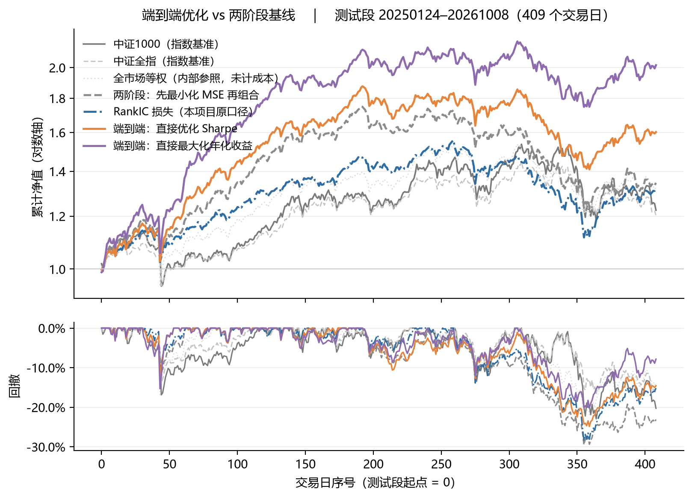

# 端到端组合优化（decision-focused）：把年化收益 / Sharpe 直接当损失反传

> 传统做法是「先预测收益的一阶矩（最小化 MSE）→ 再把预测丢进优化器出权重」。
> 但**MSE 不是决策目标**：预测误差的分布、截面对排序的敏感度、换手成本，都不在 MSE 里。
> 于是出现「预测更准、组合更差」的错配。
>
> 本模块把 **打分 → 权重 → 组合日收益（含成本）→ 组合指标**整条链路做成**可微**的，
> 直接把 **年化几何收益**或**Sharpe**当损失反传
> （Moody & Saffell 2001 的 direct reinforcement，近年称 decision-focused learning）。

年化几何收益按定义展开就是可导的：

```
年化 = (∏_t (1+r_t))^(252/n) − 1 = exp( 252 · mean_t log(1+r_t) ) − 1
```

对 `mean(log(1+r_t))` 单调递增 ⇒ 直接取负号即可当损失：`−mean(log(1+r_t))·252`，
梯度沿「组合净收益 ← 权重 ← 打分 ← 特征」一路回传到网络。

---

## 1 四种目标，只换损失

网络、组合层、随机种子、时间切分、交易成本全部相同，**唯一变量是损失**：

| 臂 | 损失 | 含义 |
|---|---|---|
| `mse` | `MSE(score, y1)`（y 按日 1%/99% 缩尾） | 两阶段的第一步：先把收益预测准 |
| `ic` | `−Pearson(score, rank(y1))` | 把排序放到标签侧的**精确** RankIC 损失 |
| `sharpe` | `−Sharpe(组合净收益序列)` | **端到端**：直接优化风险调整后收益 |
| `ret` | `−mean(log(1+r))·252` | **端到端**：直接最大化**年化几何收益**（无波动惩罚） |

> `sharpe` 臂另有 `--dsr` 选项，用 Moody–Saffell 的**差分 Sharpe**（逐期即时奖励），
> 它比"整段 Sharpe"方差更低；主表用的是整段口径。

## 2 数据

| 项 | 内容 |
|---|---|
| 来源 | **Tushare Pro**：`daily`（日线）+ `adj_factor`（复权因子）+ 涨跌停/停牌/ST 标志 |
| 区间 | **2020-01-02 ~ 2026-10-09**，1638 个交易日 |
| 截面 | A 股全市场 **5800 只**（含已退市/长期停牌，保留在面板里但被掩码剔除） |
| 价格 | **后复权**：`adj_close = close × factor`；`factor(t)=∏_{j>t}(P_prev−现金分红)/(P_prev×(1+送股率))`，除权日生效 |
| 标签 | `y1(t)` = 第 t 日收盘 → 第 t+1 日收盘的复权收益（与 `adj_close` 比值逐值一致到 6e-7） |
| 规模 | 1638×5800 单列 float32 = **36.3MB**；55 列 ≈ 1.94GB（代码一律 `mmap_mode='r'` 按日取） |

**切分**（按样本比例，不写死日期）：

| 段 | 日期 | 交易日 |
|---|---|---|
| 训练 | 2020-01-02 ~ 2024-01-17 | 982 |
| 验证 | 2024-01-18 ~ 2025-01-23 | 246 |
| 测试 | 2025-01-24 ~ 2026-10-09 | 410（有效 409） |

**可交易池**（全部只用 ≤t 的信息）：非 ST · 非停牌 · **非当日涨停** · 上市≥60 个交易日 · 近 20 日未停牌 · `y1` 有限。
日均可用 **4252 只**（占面板 73.3%）。

**标准化**：逐日**截面** z-score，截断 ±4，缺失填 0。逐日截面标准化天然无未来信息，
也避免原始量纲（成交额）压过比值类特征。

## 3 用了哪些因子

### 3.1 主配置：55 列基础量价因子（`X_base55`）

全部由 OHLCV + 复权因子 + 涨跌停/停牌标志**纯手工构造**，7 组：

| 组 | 列数 | 因子 |
|---|---|---|
| 收益与价格位置 | 14 | `ret1` `open_gap` `intraday_ret` `rng` `pos_close` `ret5` `ret10` `ret20` `ret60` `mdev5` `mdev10` `mdev20` `mdev60` `mom_5_20` |
| 波动 | 6 | `std20` `std60` `vol_ratio` `atr14` `dn_vol_20` `dd_60` |
| 量能与流动性 | 7 | `vma5` `vma20` `amt5` `amt20` `log_amt` `amihud_20` `z_amihud_20` |
| 涨跌停事件 | 8 | `lu_prev` `ld_prev` `lu5` `lu20` `lu_streak` `lu_prev_gap` `lu_prev_ret` `days_since_lu` |
| 质量/缺失 | 3 | `nan5` `nan20` `is_vol0` |
| 截面标准化 | 6 | `z_ret5` `z_ret20` `z_std20` `z_vma20` `z_log_amt` `z_mom_5_20` |
| 形态 | 3 | `lower_sh` `body_ratio` `body` |
| 市场状态 | 8 | `st_pos_all` `st_trd_all` `st_pos_big` `st_trd_big` `st_pos_sml` `st_trd_sml` `st_pos_hig` `st_trd_hig` |

定义要点：`pos_close=(c−l)/(h−l)`、`mdev_n=c/MA_n(c)−1`、`amihud_20=MA20(|ret1|/amt)`、
`dn_vol_20`=**只取下跌日**算的波动、`lu_streak`=连续涨停天数（cumsum 差）、
`st_pos_*`=分组净值位置`(nav−MA40)/STD40`、`st_trd_*`=趋势`(MA10−MA40)/STD40`
（4 组：全市场/大票/小票/高波，按成交额与波动的截面排名划分）。

> ⚠️ 8 列 `st_*` 是**逐日常数**（同一天全市场取值相同）。逐日秩口径的评分对它们免疫，
> 它们只能通过与其他因子的**交互**起作用（实测：删掉会掉 0.0120，但再加同类列也无增益）。

### 3.2 是否用了 LLM 因子：**主配置不用，且实测加进去更差**

仓库里确实有 LLM 参与挖出的因子（`X_mined`，5 列），来自另一条链路：

> **LLM Agent 挖因子**：提议器 = Claude（读规则库 + 试验日志后提表达式），
> 验证器 = 零训练病理门控 + 6 种子配对 harness。见 [`../mine/AGENT.md`](../mine/AGENT.md)。

5 条表达式（条件窗口 × 每股归一 × 双聚合，波束搜索结构性不可达的形状）：

| 名称 | 表达式含义 |
|---|---|
| `c15` | 放量日（`vma20>1`）的平均收益 |
| `c07` | 上涨日的平均量比 |
| `c25` | 涨停日的平均换手 |
| `c19` | 20 日收益的 90−10 分位差（截面离散度） |
| `c23` | 偏离度极值时点之差（时序位置信息） |

**在比赛口径 harness 里它们是"几乎可用"的**：A 种子集 `+0.0029`（t=+2.55），
但 B 种子集复验 **−0.0016（符号反转）** ⇒ 按"双种子集"纪律**未纳入**。
本项目噪声带 2σ=0.0147，+0.0029 只有它的 1/5。

**在端到端框架里我单独验了一次**（`--feat X_base55.npy,X_mined.npy`，`ret` 臂，3 种子配对）：

| 种子 | 55 列年化 | 55+5 列年化 | 55 列 Sharpe | 55+5 列 Sharpe |
|---|---|---|---|---|
| 42 | 44.8% | 30.5% | 1.94 | 1.39 |
| 43 | 46.9% | 49.0% | 2.20 | 1.75 |
| 44 | 69.7% | 56.5% | 2.31 | 1.97 |
| **平均** | **53.8%** | **45.4%** | **2.15** | **1.70** |

**3/3 全变差：年化 −8.4pp、Sharpe −0.45**，而 RankIC 反而从 0.0582 升到 0.0621。
又一次「IC 更高、组合更差」——端到端目标优化的是组合收益路径，不是截面排序；
额外 5 列把打分引向了"排序更好但持仓收益更差"的方向。

⇒ **主配置坚持 55 列，不用 LLM 因子。** 这也是本仓库一个诚实的负结果。

### 3.3 没有用到的数据

`_ts/` 里已拉的 **东财资金流、两融、指数估值**（`moneyflow_dc` / `margin_detail` / `index_dailybasic`）
**没有进这个模型**：前两者覆盖率与字段稳定性不足，后者是逐日常数（对秩口径免疫）。
指数类目前只用作**基准**（见下节），不用作特征。

## 4 Benchmark

原来只有一个「全市场等权」内部参照（同一可交易池、零成本、不可投资），
它适合隔离"选股"这一件事，**但不能对外当基准**。因此新增 `benchmark.py`，
从 **Tushare** 拉真实可买的指数并对齐到面板交易日：

| 代码 | 名称 | 测试段年化 | 波动 | Sharpe | MDD |
|---|---|---|---|---|---|
| **000852.SH** | **中证1000**（★ 主基准） | **13.3%** | 25.0% | 0.53 | −22.9% |
| 932000.CSI | 中证2000 | 18.4% | 26.6% | 0.69 | −27.5% |
| 000905.SH | 中证500 | 17.4% | 24.1% | 0.72 | −19.7% |
| 000985.CSI | 中证全指 | 12.0% | 20.0% | 0.60 | −16.9% |
| 399303.SZ | 国证2000 | 16.2% | 25.9% | 0.62 | −24.9% |
| 000300.SH | 沪深300 | 8.0% | 16.9% | 0.47 | −14.8% |
| 000001.SH | 上证指数 | 10.7% | 14.2% | 0.76 | −11.3% |

**为什么选「中证1000」当主基准**：策略从全市场选 80 只等权持有，市值与波动分布最接近中小盘；
中证1000 的波动（25.0%）与策略（20~23%）最可比。用沪深300 会因风格差异把超额说得虚高，
用中证2000 又会因这段样本小盘更强而把超额说得偏保守。

**两种超额口径要分清**（很容易混）：

- **算术超额** = 策略年化 − 基准年化（简单相减，忽略波动与复利拖累）
- **几何超额** = `∏(1+r_s)/∏(1+r_b)` 的年化（"真的多赚了多少"）

| 臂 | 年化 | 算术超额 vs 中证1000 | **几何超额 vs 中证1000** | IR | 几何超额 vs 中证全指 |
|---|---|---|---|---|---|
| `mse` | 20.1% | +6.8pp | **−0.3%** | 0.15 | +8.0% |
| `ic` | 18.8% | +5.5pp | **−1.5%** | 0.11 | +6.7% |
| `sharpe` | 33.7% | +20.4pp | **+10.8%** | 0.47 | +21.7% |
| `ret` | 54.1% | +40.8pp | **+27.6%** | 0.87 | +42.0% |

**这张表比年化本身更重要**：两条**两阶段**臂的算术超额是正的（+6.8/+5.5pp），
但**几何超额是 0 或负**——复利之后它们**并没有真正跑赢中证1000**。
只有端到端两条臂才有真实超额。也就是说「预测更准」在两阶段框架里换不到钱。

## 5 三个实现要点（少一个就跑不出像样的结果）

1. **组合层必须可微**：`top-k 选股 + 组内 softmax 加权`。
   若用「等权 top-k」，权重对分数是分段常数 ⇒ 梯度为 0，端到端退化成"只学选谁"。
2. **必须截断权重集中度**：组内 z 分数截到 ±3 再 softmax。
   不截断时实测出现过**单票 51% 权重**，80 只组合的日收益被推到 +29%（不可能值，
   第一版就是这样跑出"+330%/年、Sharpe 5.0"的假结果）。
3. **成本要进损失**：`15bp × Σ|w_t − w_{t−1}|`。
   否则模型没有"少动"的动机，年化换手会超过 100 倍、成本拖累 14%/年。

## 6 数据卫生（这一段比模型更重要）

面板里 `|y1| > 30%` 的 2875 个格子中，**85.4% 是上市不足 60 个交易日的新股**
（首日无涨跌幅限制、复牌跳空），最大单日收益 **+2004%**。
不剔除时，任何等权组合的日收益都会出现 +29% 这种不可能值。

## 7 结果（测试段 2025-01-24 ~ 2026-10-08，409 日，3 种子平均）

| 臂 | 年化 | 波动 | **Sharpe** | 种子间 sd | MDD | **RankIC** | 年化换手 |
|---|---|---|---|---|---|---|---|
| 两阶段 MSE | 20.1% | 20.4% | 0.98 | 0.20 | −29.5% | **0.0791** | 40 |
| RankIC 损失 | 18.8% | 19.8% | 0.95 | 0.64 | −28.4% | **0.0883** | 47 |
| **端到端 Sharpe** | 33.7% | 20.4% | 1.65 | 0.31 | −24.9% | 0.0596 | 44 |
| **端到端 年化收益** | **54.1%** | 23.3% | **2.32** | 0.19 | **−20.2%** | 0.0582 | 44 |
| 中证1000（主基准） | 13.3% | 25.0% | 0.53 | — | −22.9% | — | — |
| 中证全指 | 12.0% | 20.0% | 0.60 | — | −16.9% | — | — |
| 全市场等权（内部参照，未计成本） | 18.9% | 22.4% | 0.84 | — | −21.9% | — | — |

> 表里的 Sharpe 是「3 种子平均日收益」的 Sharpe；种子间 sd 是**逐种子 Sharpe** 的离散度。

**四点读法**

1. **IC 排序 ≠ 业绩排序**：IC 最高的臂（0.0883）Sharpe 只有 0.95；IC **最低**的臂（0.0582）Sharpe **2.32**。
2. **相对两阶段 +0.67 Sharpe**（逐种子差 +1.01/+0.40/+0.59，3/3 同向，t≈3.7）。
3. **「最大化收益」比「最大化 Sharpe」还猛**：年化 54.1% vs 33.7%、Sharpe 2.32 vs 1.65、
   回撤反而更小（−20.2% vs −24.9%）。说明这段样本里**波动惩罚是有代价的**——
   Sharpe 目标为了压低分母放弃了太多分子。但收益目标无波动约束，**过拟合风险也最大**。
4. **只有端到端臂有真实超额**（见 §4 几何超额表）；两阶段臂"算术上赢、几何上不赢"。



## 8 复现

```bash
# 0) 环境
pip install -r ../requirements.txt          # torch / numpy / pandas / matplotlib / tushare

# 1) 基准（一次即可，缓存到 _ts/bench/benchmark.parquet）
export TUSHARE_TOKEN=你的token
python benchmark.py

# 2) 单跑一臂
python train.py --arm ret --seed 42 --topk 80 --temp 2.0 --rebal 10

# 3) 四臂 × 三种子（≈9 分钟，CPU 4 线程）
bash run_all.sh

# 4) 汇总：净值曲线 + 回撤 + 指标表（自动叠加指数基准）
python backtest.py
```

数据目录用环境变量指定（默认 `<上级目录>/panel`、`<上级目录>/feat`）：

```bash
SF_PANEL=/path/to/panel SF_FEAT=/path/to/feat python train.py --arm ret
```

可选：加 LLM 挖掘的 5 列（本仓库默认不加，理由见 §3.2）

```bash
python train.py --arm ret --feat "X_base55.npy,X_mined.npy" --tag mined
```

产出：`results/E2E-Sharpe-策略净值-<时间戳>.png`、`results/e2e_metrics.csv`、`results/e2e_<arm>_s<seed>.json`。

## 9 局限（别把这张图当实盘预期）

- **只有 3 个随机种子**，`ic` 臂的种子间 sd 高达 0.64 ⇒ 该臂与端到端的差异在噪声内；
  只有"对两阶段"的差异是 3/3 同向的（t≈3.7，n=3 仍偏少）。
- **单段测试，且 epoch 是在验证集上按 Sharpe 选的** ⇒ 测试指标偏乐观，未做多重比较校正
  （对 `ret` 臂尤其**保守**：选 epoch 的判据与它的目标不一致）。
- 80 只等权 + 10 日调仓，**未计冲击成本与容量**；15bp/边只是粗估。
- `topk / temp / rebal / cost` 未做敏感性扫描，这四项都可能改变排序。
- **基准指数是价格指数、不含分红再投**（`index_daily` 口径），对高股息组合会低估基准，
  即**略微高估超额**；严格口径应改用全收益指数（中证全收益系列）。
- 组合层是 `top-k + softmax`，**不是带协方差矩阵的均值-方差优化**。
  后者需要可微的 MV 层（cvxpy 层或对角 Σ 的解析解），是明确的下一步。
