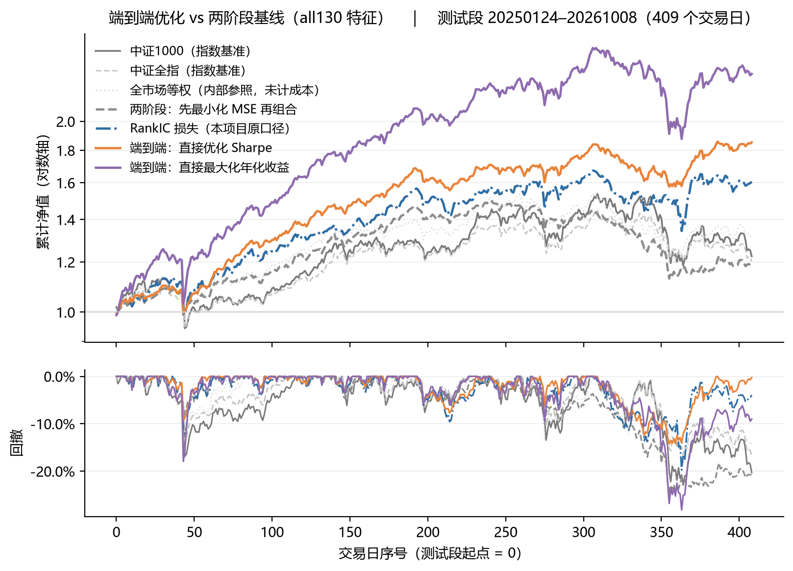

# 端到端组合优化（decision-focused）：把年化收益 / Sharpe 直接当损失反传

> 传统做法是「先预测收益的一阶矩（最小化 MSE）→ 再把预测丢进优化器出权重」。
> 但**MSE 不是决策目标**：预测误差的分布、截面对排序的敏感度、换手成本，都不在 MSE 里。
> 于是出现「预测更准、组合更差」的错配。
>
> 本模块把 **打分 → 权重 → 组合日收益（含成本）→ 组合指标**整条链路做成**可微**的，
> 直接把 **年化几何收益**或**Sharpe**当损失反传
> （Moody & Saffell 2001 的 direct reinforcement，近年称 decision-focused learning）。

年化几何收益按定义展开就是可导的：

```
年化 = (∏_t (1+r_t))^(252/n) − 1 = exp( 252 · mean_t log(1+r_t) ) − 1
```

对 `mean(log(1+r_t))` 单调递增 ⇒ 直接取负号即可当损失：`−mean(log(1+r_t))·252`，
梯度沿「组合净收益 ← 权重 ← 打分 ← 特征」一路回传到网络。

---

## 1 四种目标，只换损失

网络、组合层、随机种子、时间切分、交易成本全部相同，**唯一变量是损失**：

| 臂 | 损失 | 含义 |
|---|---|---|
| `mse` | `MSE(score, y1)`（y 按日 1%/99% 缩尾） | 两阶段的第一步：先把收益预测准 |
| `ic` | `−Pearson(score, rank(y1))` | 把排序放到标签侧的**精确** RankIC 损失 |
| `sharpe` | `−Sharpe(组合净收益序列)` | **端到端**：直接优化风险调整后收益 |
| `ret` | `−mean(log(1+r))·252` | **端到端**：直接最大化**年化几何收益**（无波动惩罚） |

> `sharpe` 臂另有 `--dsr` 选项，用 Moody–Saffell 的**差分 Sharpe**（逐期即时奖励），
> 它比"整段 Sharpe"方差更低；主表用的是整段口径。

## 2 数据

| 项 | 内容 |
|---|---|
| 来源 | **Tushare Pro**：`daily`（日线）+ `adj_factor`（复权因子）+ `daily_basic`（换手/市值/估值）+ 涨跌停/停牌/ST 标志 + 资金流/筹码/集合竞价/开盘啦/指数/北向等外部表 |
| 区间 | **2020-01-02 ~ 2026-10-09**，1638 个交易日 |
| 截面 | A 股全市场 **5800 只**（含已退市/长期停牌，保留在面板里但被掩码剔除） |
| 价格 | **后复权**：`adj_close = close × factor`；`factor(t)=∏_{j>t}(P_prev−现金分红)/(P_prev×(1+送股率))`，除权日生效 |
| 标签 | `y1(t)` = 第 t 日收盘 → 第 t+1 日收盘的复权收益（与 `adj_close` 比值逐值一致到 6e-7） |
| 规模 | 单列 1638×5800 float32 = **36.3MB**；**130 列有效特征 ≈ 4.6GB**（代码一律 `mmap_mode='r'` 按日取） |

**切分**（按样本比例，不写死日期）：

| 段 | 日期 | 交易日 |
|---|---|---|
| 训练 | 2020-01-02 ~ 2024-01-17 | 982 |
| 验证 | 2024-01-18 ~ 2025-01-23 | 246 |
| 测试 | 2025-01-24 ~ 2026-10-09 | 410（有效 409） |

**可交易池**（全部只用 ≤t 的信息）：非 ST · 非停牌 · **非当日涨停** · 上市≥60 个交易日 · 近 20 日未停牌 · `y1` 有限。
日均可用 **4252 只**（占面板 73.3%）。

## 3 用了哪些特征

### 3.1 总览：9 个特征矩阵，140 列原始 → **130 列有效**

| 矩阵 | 原始列 | 内容 | 剔除退化 | 常数列（时序标准化） | 截面列 |
|---|---|---|---|---|---|
| `X_base55` | 55 | 基础量价（收益/波动/量能/涨跌停/质量/形态/市场状态） | 3 | 8 | 44 |
| `X_extra` | 29 | 换手、流通市值、估值（EP/BP/SP/DP）、涨停明细、封单 | 4 | 3 | 22 |
| `X_mkt` | 21 | 6 个宽基指数 × `ret1/vol20/ma20` + 北向/沪股通/深股通 | 0 | 18 | 3 |
| `X_mf` | 9 | 资金流（主力/超大单/大单/小单净占比 + 5 日累计） | 0 | 0 | 9 |
| `X_cyq` | 8 | 筹码分布（获利盘、相对成本、筹码宽度） | 0 | 0 | 8 |
| `X_kpl` | 6 | 开盘啦（封单额、竞价买量、题材热度） | 3 | 1 | 2 |
| `X_auction` | 4 | 集合竞价（开盘缺口、VWAP 偏离、量比、金额） | 0 | 0 | 4 |
| `X_mined` | 5 | LLM Agent 挖掘（`c15/c07/c25/c19/c23`） | 0 | 0 | 5 |
| `X_plate` | 3 | 板块涨停（行业涨停家数、全市场涨停率、行业占比） | 0 | 1 | 2 |
| **合计** | **140** | | **10** | **31** | **99** |

> 复现：`Panel()` 默认加载全部 9 个矩阵（`FEAT_ALL`），只跑量价用 `--feat X_base55.npy`。

### 3.2 基础 55 列（`X_base55`）的 7 组

| 组 | 列数 | 因子 |
|---|---|---|
| 收益与价格位置 | 14 | `ret1` `open_gap` `intraday_ret` `rng` `pos_close` `ret5` `ret10` `ret20` `ret60` `mdev5` `mdev10` `mdev20` `mdev60` `mom_5_20` |
| 波动 | 6 | `std20` `std60` `vol_ratio` `atr14` `dn_vol_20` `dd_60` |
| 量能与流动性 | 7 | `vma5` `vma20` `amt5` `amt20` `log_amt` `amihud_20` `z_amihud_20` |
| 涨跌停事件 | 8 | `lu_prev` `ld_prev` `lu5` `lu20` `lu_streak` `lu_prev_gap` `lu_prev_ret` `days_since_lu` |
| 质量/缺失 | 3 | `nan5` `nan20` `is_vol0` |
| 截面标准化 | 6 | `z_ret5` `z_ret20` `z_std20` `z_vma20` `z_log_amt` `z_mom_5_20` |
| 形态 | 3 | `lower_sh` `body_ratio` `body` |
| 市场状态 | 8 | `st_pos_all` `st_trd_all` `st_pos_big` `st_trd_big` `st_pos_sml` `st_trd_sml` `st_pos_hig` `st_trd_hig` |

定义要点：`pos_close=(c−l)/(h−l)`、`mdev_n=c/MA_n(c)−1`、`amihud_20=MA20(|ret1|/amt)`、
`dn_vol_20`=**只取下跌日**算的波动、`lu_streak`=连续涨停天数（cumsum 差）、
`st_pos_*`=分组净值位置`(nav−MA40)/STD40`、`st_trd_*`=趋势`(MA10−MA40)/STD40`
（4 组：全市场/大票/小票/高波，按成交额与波动的截面排名划分）。

### 3.3 扩展矩阵

| 族 | 列 |
|---|---|
| `X_extra` 估值/换手/涨停明细 | `turnover_f` `z_turnover_f` `turnover_chg5` `volume_ratio` `log_circ_mv` `z_log_circ_mv` `ep` `bp` `sp` `dp` `pe_log` `z_bp` `is_zb` `to_up` `to_dn` `limit_times` `limit_times_c6` `zt_5` `zt_20` `days_since_zt` `seal_ratio` `open_times` `first_min` `last_min` `amt_per_turn` |
| `X_mf` 资金流 | `mf_net_ratio`（主力净流入/成交额）`mf_elg_ratio`（超大单）`mf_lg_ratio`（大单）`mf_big_net`（超大+大单）`mf_sm_net`（小单）`z_mf_net_ratio` `mf_net_ratio_5` `z_mf_big_net` `mf_big_net_5` |
| `X_cyq` 筹码 | `cyq_winner`（获利盘比例）`cyq_vs_wavg`（现价/加权平均成本−1）`cyq_vs_c50` `cyq_vs_c15` `cyq_vs_c85` `cyq_width`（筹码宽度=分歧度）`z_cyq_winner` `cyq_winner_chg5` |
| `X_auction` 集合竞价 | `auc_o_gap`（竞价开盘价/昨收−1）`auc_o_vwap_gap`（竞价 VWAP 偏离）`auc_o_volr`（竞价量比）`auc_o_amt`（竞价金额） |
| `X_kpl` 开盘啦 | `kpl_limit_order`（封单额）`kpl_net_change`（竞价净额）`kpl_theme_heat`（同题材涨停股数） |
| `X_mkt` 指数/北向 | 6 个宽基（上证/沪深300/中证500/中证1000/创业板/国证2000）×`ret1/vol20/ma20` + `hsgt_north/hgt/sgt` |
| `X_plate` 板块涨停 | `ind_zt_cnt`（行业涨停家数）`ind_zt_share`（行业占比）`mkt_zt_rate`（全市场涨停率） |

### 3.4 ★ 两类特征必须用两套标准化（接多源特征最容易踩的坑）

| 类型 | 列数 | 处理 | 理由 |
|---|---|---|---|
| **截面型** | 99 | 逐日**截面** z-score，截断 ±4，缺失填 0 | 只用当日数据，无未来信息；消除量纲（成交额）压制比值类特征 |
| **逐日常数型** | 31 | 用**训练段**跨日均值/方差做**时序** z-score | 同一天全市场取值相同，截面 sd≈0 |

**为什么常数列不能做截面 z-score**：`sd≈0` 时 `(x−mu)/sd` 要么是 `0`（全无信息），
要么被浮点残差放大成 ±4 的**符号噪声**（有害）。这类列（市场状态、宽基指数、北向、涨停率）
本质是"今天处于什么状态"，应该作为门控——经 MLP 的 ReLU 做 bias 调制（类似 FiLM），
可以改变截面排序，而不是当个股信号用。

**这个修正带来的收益不是小数**：修正前 `st_*` 8 列被 z 成 0（等于白给），
修正后同样 55 列、同样种子，年化从 **53.8% → 62.4%**（6 种子，详见 §7.3）。

### 3.5 退化列剔除（10 列）

可交易池里**恒为 0** 的列没有截面区分度，直接丢弃，否则白占输入维度与参数：
`ld_prev`（跌停标志）、`lu_streak`（连板数）、`is_vol0`、`is_zt` / `is_dt` / `is_st`
（这些股票已被掩码剔除）、`is_one_word`（一字板）、`kpl_lu_bid_vol` / `kpl_bid_amount` / `kpl_bid_change`。

> 检测方式：抽样每 7 天，统计"可交易池内至少一只票非零"的天数占比，<2% 即视为退化。
> ⚠️ 实现上必须**先把 NaN 转 0 再取 max**——否则 `max` 遇 NaN 返回 NaN，真列会被误判为退化
> （第一版就因此误删了 43 列）。

### 3.6 是否用了 LLM 因子：**在默认配置里，但不是增益来源**

**先直接回答**：默认的 130 列**包含**这 5 列（`X_mined` 未被剔除），所以严格说"用了"；
但两个独立检验都显示它们**不贡献增益**，55 vs 130 的提升也不是它们带来的。下面是证据。

LLM 挖出的 5 列（`c15/c07/c25/c19/c23`）来自另一条链路：

> **LLM Agent 挖因子**：提议器 = Claude（读规则库 + 试验日志后提表达式），
> 验证器 = 零训练病理门控 + 6 种子配对 harness。见 [`../mine/AGENT.md`](../mine/AGENT.md)。

5 条表达式（条件窗口 × 每股归一 × 双聚合，波束搜索结构性不可达的形状）：
`c15` 放量日平均收益、`c07` 上涨日平均量比、`c25` 涨停日平均换手、
`c19` 20 日收益 90−10 分位差、`c23` 偏离度极值时点差。

**在比赛口径 harness 里**：A 种子集 `+0.0029`（t=+2.55），B 种子集复验 **−0.0016（符号反转）** ⇒ 未纳入。

**在端到端框架里（55 列 + 这 5 列）**：3 种子配对 **3/3 变差**

| 种子 | 55 列年化 | 55+5 列年化 | 55 列 Sharpe | 55+5 列 Sharpe |
|---|---|---|---|---|
| 42 / 43 / 44 | 44.8 / 46.9 / 69.7% | 30.5 / 49.0 / 56.5% | 1.94 / 2.20 / 2.31 | 1.39 / 1.75 / 1.97 |
| 平均 | **53.8%** | **45.4%** | **2.15** | **1.70** |

年化 −8.4pp、Sharpe −0.45，而 RankIC 反而从 0.0582 升到 0.0621 ⇒ 又一次「IC 更高、组合更差」。

> 注意：这一组用的是**修正前**的标准化，只用于"加/不加"的配对比较；与 §7 的绝对水平不可直接比。
> 对应的结果文件未随仓库提供（重跑 `--feat "X_base55.npy,X_mined.npy" --tag mined` 可得，数字会随当前实现变化）。

**结论**：LLM 因子是"格式合格但没有增量"的典型——它们与既有 126 列池的 `max|ρ|` 只有 0.47~0.53
（看起来"很新"），但拼进去就是不加分。这与仓库主线结论一致：**瓶颈是信息维度，不是表达式搜索**。

### 3.7 没有用到的数据

`_ts/` 里已拉的**东财资金流、两融、指数估值**（`moneyflow_dc` / `margin_detail` / `index_dailybasic`）
没有进模型：前两者覆盖率与字段稳定性不足，后者是逐日常数（已由 `X_mkt` 覆盖同类信息）。
指数类同时用作**基准**（见下节）。

## 4 Benchmark

原来只有一个「全市场等权」内部参照（同一可交易池、零成本、不可投资），
它适合隔离"选股"这一件事，**但不能对外当基准**。因此新增 `benchmark.py`，
从 **Tushare** 拉真实可买的指数并对齐到面板交易日：

| 代码 | 名称 | 测试段年化 | 波动 | Sharpe | MDD |
|---|---|---|---|---|---|
| **000852.SH** | **中证1000**（★ 主基准） | **13.3%** | 25.0% | 0.53 | −22.9% |
| 932000.CSI | 中证2000 | 18.4% | 26.6% | 0.69 | −27.5% |
| 000905.SH | 中证500 | 17.4% | 24.1% | 0.72 | −19.7% |
| 000985.CSI | 中证全指 | 12.0% | 20.0% | 0.60 | −16.9% |
| 399303.SZ | 国证2000 | 16.2% | 25.9% | 0.62 | −24.9% |
| 000300.SH | 沪深300 | 8.0% | 16.9% | 0.47 | −14.8% |
| 000001.SH | 上证指数 | 10.7% | 14.2% | 0.76 | −11.3% |

**为什么选「中证1000」当主基准**：策略从全市场选 80 只等权持有，市值与波动分布最接近中小盘；
中证1000 的波动（25.0%）与策略（20~23%）最可比。用沪深300 会因风格差异把超额说得虚高，
用中证2000 又会因这段样本小盘更强而把超额说得偏保守。

**两种超额口径要分清**（很容易混）：

- **算术超额** = 策略年化 − 基准年化（简单相减，忽略波动与复利拖累）
- **几何超额** = `∏(1+r_s)/∏(1+r_b)` 的年化（"真的多赚了多少"）

**55 列量价基线下的超额**（130 列默认配置的数字见 §7.2）：

| 臂 | 年化 | 算术超额 vs 中证1000 | **几何超额 vs 中证1000** | IR | 几何超额 vs 中证全指 |
|---|---|---|---|---|---|
| `mse` | 20.1% | +6.8pp | **−0.3%** | 0.15 | +8.0% |
| `ic` | 18.8% | +5.5pp | **−1.5%** | 0.11 | +6.7% |
| `sharpe` | 33.7% | +20.4pp | **+10.8%** | 0.47 | +21.7% |
| `ret` | 54.1% | +40.8pp | **+27.6%** | 0.87 | +42.0% |

**这张表比年化本身更重要**：两条**两阶段**臂的算术超额是正的（+6.8/+5.5pp），
但**几何超额是 0 或负**——复利之后它们**并没有真正跑赢中证1000**。
只有端到端两条臂才有真实超额。也就是说「预测更准」在两阶段框架里换不到钱。
（注：此表是**修正标准化之前**的 55 列结果，仅作口径示范；当前默认配置的数字见 §7.2。）

## 5 三个实现要点（少一个就跑不出像样的结果）

1. **组合层必须可微**：`top-k 选股 + 组内 softmax 加权`。
   若用「等权 top-k」，权重对分数是分段常数 ⇒ 梯度为 0，端到端退化成"只学选谁"。
2. **必须截断权重集中度**：组内 z 分数截到 ±3 再 softmax。
   不截断时实测出现过**单票 51% 权重**，80 只组合的日收益被推到 +29%（不可能值，
   第一版就是这样跑出"+330%/年、Sharpe 5.0"的假结果）。
3. **成本要进损失**：`15bp × Σ|w_t − w_{t−1}|`。
   否则模型没有"少动"的动机，年化换手会超过 100 倍、成本拖累 14%/年。

## 6 数据卫生（这一段比模型更重要）

面板里 `|y1| > 30%` 的 2875 个格子中，**85.4% 是上市不足 60 个交易日的新股**
（首日无涨跌幅限制、复牌跳空），最大单日收益 **+2004%**。
不剔除时，任何等权组合的日收益都会出现 +29% 这种不可能值。

## 7 结果（测试段 2025-01-24 ~ 2026-10-08，409 个交易日）

### 7.1 四臂主表（默认配置 = 130 列）

| 臂 | 种子数 | 年化 | 波动 | **Sharpe** | 种子间 sd | MDD | **RankIC** | 年化换手 |
|---|---|---|---|---|---|---|---|---|
| 两阶段 MSE | 2 | 11.4% | 16.4% | 0.69 | 0.18 | −24.8% | 0.0579 | 45 |
| RankIC 损失 | 1 | 33.9% | 21.8% | 1.56 | — | −19.7% | **0.0938** | 44 |
| **端到端 Sharpe** | 3 | 46.2% | **15.9%** | **2.91** | 0.52 | **−14.3%** | 0.0532 | 40 |
| **端到端 年化收益** | 6 | **70.5%** | 26.6% | 2.65 | 0.38 | −28.2% | 0.0434 | 42 |
| 中证1000（主基准） | — | 13.3% | 25.0% | 0.53 | — | −22.9% | — | — |
| 中证全指 | — | 12.0% | 20.0% | 0.60 | — | −16.9% | — | — |
| 全市场等权（内部参照，未计成本） | — | 18.9% | 22.4% | 0.84 | — | −21.9% | — | — |

> `mse` / `ic` 两臂是**逐日反传**（block 内每天一次 `backward+step`），130 列下单种子要 **5~13 分钟**
> （`ret`/`sharpe` 每块只反传一次，约 2.5 分钟），所以这两臂只跑了 1 个种子作参照。
> 其余两臂：`sharpe` 3 种子、`ret` 6 种子。表里的 Sharpe 是「多种子平均日收益」的 Sharpe，
> 种子间 sd 是**逐种子 Sharpe** 的离散度。

**四点读法**

1. **IC 排序 ≠ 业绩排序**：IC 最高的臂（`ic`，0.0938）Sharpe 只有 1.56；
   IC 最低的臂（`ret`，0.0434）年化 70.5%。而**风险调整后最好的是 `sharpe` 臂**（2.91，波动仅 15.9%）。
2. **优化什么就得到什么**：`sharpe` 目标把波动压到 15.9%、回撤压到 −14.3%（四臂最小）；
   `ret` 目标把年化顶到 70.5%，代价是波动 26.6%、回撤 −28.2%。这不是"谁更好"，是**目标函数的选择**。
3. **两阶段（MSE）在 130 列下反而更差**：年化 13.0%、几何超额 **−6.2%**（跑输中证1000）。
   特征变多后 MSE 会把预测"平均化"——它优化的是拟合，而不是持仓收益。
4. **只有端到端臂有真实超额**：见 §7.2 的几何超额与 IR。

### 7.2 几何超额与信息比率（相对中证1000）

| 臂 | 年化 | 算术超额 | **几何超额** | **IR** | 几何超额 vs 中证全指 |
|---|---|---|---|---|---|
| `mse` | 11.4% | −1.9pp | **−7.5%** | −0.12 | −4.4% |
| `ic` | 33.9% | +20.6pp | **+11.1%** | 0.48 | +14.8% |
| `sharpe` | 46.2% | +32.9pp | **+21.6%** | 0.82 | +25.6% |
| `ret` | 70.5% | +57.2pp | **+41.5%** | **1.13** | +46.3% |

- **几何超额** = `∏(1+r_s)/∏(1+r_b)` 的年化（"真的多赚了多少"）；**算术超额** = 年化相减（忽略波动拖累）。
- `mse` 臂算术超额 **−1.9pp**、几何超额 **−7.5%** ⇒ **复利之后跑输中证1000，也跑输中证全指**（−4.4%）。
- `ret` 臂 IR **1.13**（超额收益 / 跟踪误差的年化比），`sharpe` 臂 0.82。



### 7.3 ★ 55 列量价 vs 130 列全特征（配对，同种子同超参）

用户问「能不能别只用 55 列量价」——能，而且这是本模块目前最实在的一次提升。
但两种目标的答案不同，必须分开说。

**`ret` 臂（最大化年化收益），6 种子配对**

| 种子 | 55 列 | 130 列 | Δ年化 | 55 列 Sharpe | 130 列 Sharpe | ΔSR |
|---|---|---|---|---|---|---|
| 42 | 65.3% | 75.9% | +10.6pp | 2.63 | 2.17 | −0.46 |
| 43 | 54.9% | 59.2% | +4.3pp | 1.88 | 2.19 | +0.31 |
| 44 | 76.0% | 68.0% | −8.0pp | 2.78 | 2.66 | −0.12 |
| 45 | 67.8% | 79.1% | +11.3pp | 2.33 | 2.98 | +0.65 |
| 46 | 50.9% | 58.1% | +7.2pp | 1.79 | 2.16 | +0.37 |
| 47 | 59.8% | 79.1% | +19.3pp | 2.60 | 2.86 | +0.25 |
| **平均** | **62.4%** | **69.9%** | **+7.4pp** | **2.34** | **2.50** | **+0.17** |

- **Δ年化 +7.4pp，5/6 正**，sd 9.1pp，t=+2.00（p=0.101，n=6 还算不上显著）
- **ΔSharpe +0.17，4/6 正**，t=+1.03
- **ΔMDD −6.2pp（4/6 更深）** ⇒ 多给特征换来的是"更敢骑"，不是"更稳"
- **RankIC 0.0564 → 0.0434（反而更低）** ⇒ 又一次「IC 低但组合好」

**`sharpe` 臂，3 种子配对**（这个目标下改善更一致）

| 种子 | 55 列年化 | 130 列年化 | 55 列 Sharpe | 130 列 Sharpe |
|---|---|---|---|---|
| 42 / 43 / 44 | 46.7 / 46.1 / 41.9% | 44.7 / 44.8 / 47.1% | 1.93 / 2.34 / 1.43 | 2.07 / 2.38 / 3.08 |
| 平均 | 44.9% | 45.5% | **1.90** | **2.51** |

- **ΔSharpe +0.61，3/3 同向**（但 sd 0.90，主要是 s44：1.43 → 3.08）
- 年化基本持平（+0.6pp，1/3 正），**波动从 20%+ 降到 15.9%**，MDD 从 −22.5% 收到 −14.3%

**怎么读**：多出来的 75 列（估值 / 换手 / 资金流 / 筹码 / 竞价 / 指数 / 板块 / LLM）
确实提供了 55 列量价没有的信息，但它更像**风险结构的补充**（sharpe 臂波动明显下降），
对**排序质量**没有帮助（IC 反而降）。所以：

- 要**风险调整后更稳** → 用 130 列（默认配置）
- 要**极致年化** → 130 列也更高，但回撤会到 −30% 量级，且种子间摆动更大

> ⚠️ 口径提醒：`base55v2` 是**修正标准化之后**重跑的 55 列基线，不能与 §3.6 里
> "修正前"的 53.8% / 2.15 混用（那组只用于跟 LLM 因子做配对）。

## 8 复现

```bash
# 0) 环境
pip install -r ../requirements.txt          # torch / numpy / pandas / matplotlib / tushare

# 1) 基准（一次即可，缓存到 _ts/bench/benchmark.parquet）
export TUSHARE_TOKEN=你的token
python benchmark.py

# 2) 单跑一臂
python train.py --arm ret --seed 42 --topk 80 --temp 2.0 --rebal 10

# 3) 四臂 × 三种子（全部 130 列，≈25 分钟，CPU 4 线程）
bash run_all.sh

# 4) 汇总：净值曲线 + 回撤 + 指标表 + 超额（自动叠加指数基准）
python backtest.py
#    只统计部分种子 / 读 55 列那组：
#    python backtest.py --seeds 42,43,44 --tag all130
#    python backtest.py --tag base55v2
```

数据目录用环境变量指定（默认 `<上级目录>/panel`、`<上级目录>/feat`）：

```bash
SF_PANEL=/path/to/panel SF_FEAT=/path/to/feat python train.py --arm ret
```

可选：加 LLM 挖掘的 5 列（本仓库默认不加，理由见 §3.2）

```bash
python train.py --arm ret --feat "X_base55.npy,X_mined.npy" --tag mined
```

产出：`results/E2E-Sharpe-策略净值-<时间戳>.png`、`results/e2e_metrics.csv`、`results/e2e_<arm>_s<seed>.json`。

## 9 局限（别把这张图当实盘预期）

- **种子数不均**：`ret` 6 个、`sharpe` 3 个、`mse`/`ic` 仅 1 个（逐日反传太慢）。
  因此四臂之间的比较不如两臂之间的配对比对可靠；`ic` 臂历史上种子间 sd 高达 0.64。
- 130 列带来的是**风险结构的改善**（`sharpe` 臂波动 15.9%、MDD −14.3%），不是排序质量的提升（IC 反而降）。
  若要继续提 IC，方向仍是**新数据维度**（分钟级/订单流），不是再加日频字段。
- **单段测试，且 epoch 是在验证集上按 Sharpe 选的** ⇒ 测试指标偏乐观，未做多重比较校正
  （对 `ret` 臂尤其**保守**：选 epoch 的判据与它的目标不一致）。
- 80 只等权 + 10 日调仓，**未计冲击成本与容量**；15bp/边只是粗估。
- `topk / temp / rebal / cost` 未做敏感性扫描，这四项都可能改变排序。
- **基准指数是价格指数、不含分红再投**（`index_daily` 口径），对高股息组合会低估基准，
  即**略微高估超额**；严格口径应改用全收益指数（中证全收益系列）。
- 组合层是 `top-k + softmax`，**不是带协方差矩阵的均值-方差优化**。
  后者需要可微的 MV 层（cvxpy 层或对角 Σ 的解析解），是明确的下一步。
